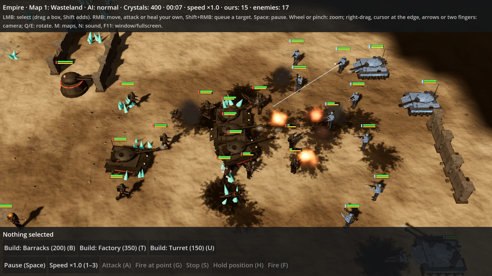
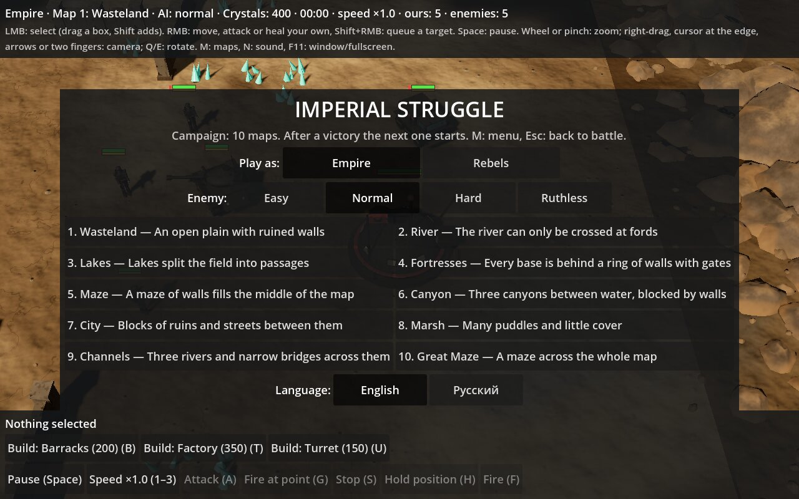
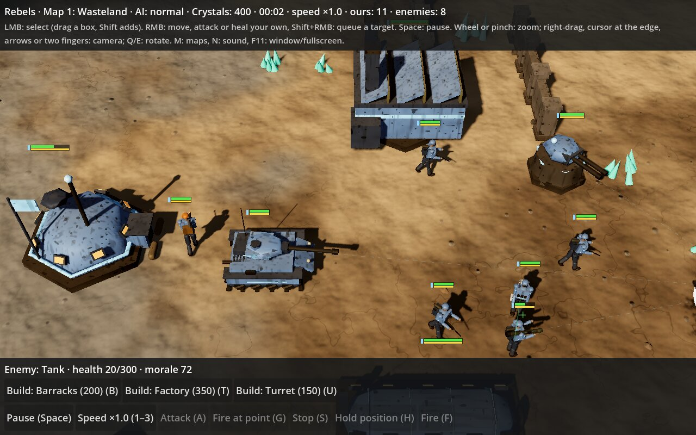
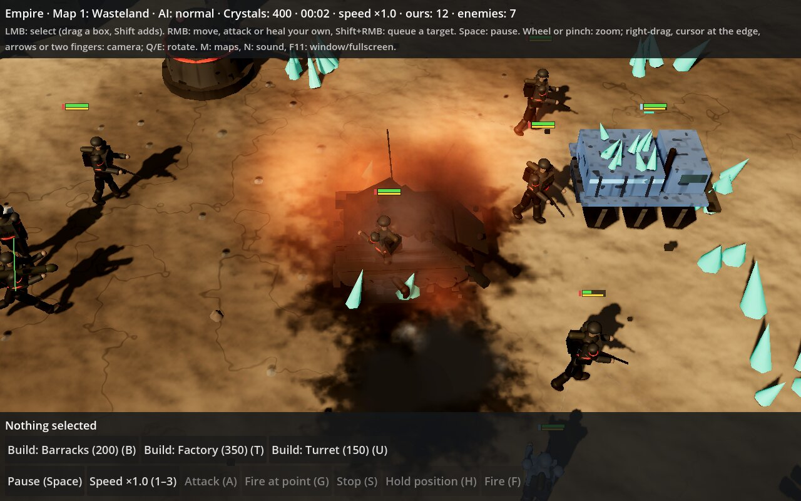

# Imperial Struggle

> **This whole game was made by Claude, the AI assistant from [Anthropic](https://www.anthropic.com), at the request of
> Boris ([@boriay](https://github.com/boriay)).** Boris came up with the game, set the tasks and tested the results.
> All the code, the procedural 3D models and shaders, the synthesized sounds, the maps, the enemy AI, the tests
> and this README were written by Claude. The game uses no third-party models, textures or sounds.

A slow-paced RTS where you micro-manage every single unit. Engine: Godot 4.5.

| | | |
| --- | --- | --- |
|  |  |  |

## How to run

1. Install Godot 4.5 from https://godotengine.org/download.
2. Clone the repository, press **Import** in Godot and pick `project.godot` in the repository root.
3. Press F5.

The game starts in English. You can switch the interface to Russian (English / Русский) in the main menu, and the game remembers the choice.

To build the macOS app: in Godot choose **Project → Export → macOS → Export Project** (you need the Godot 4.5.1
export templates). This produces `export/ImperialStruggle-macOS.zip`. Unpack it and drag
`Imperial Struggle.app` into Applications.

The build is not signed with an Apple certificate and not notarized, so on first launch macOS says
"Apple could not verify "Imperial Struggle" is free of malware". This is expected. To allow it, do one of these:

1. Try to open the app and close the warning with "Done". Open System Settings →
   Privacy & Security, scroll down to the message about Imperial Struggle and press "Open Anyway",
   then confirm with your password. After that the app opens normally.
2. Or run this in Terminal (you can paste the path by dragging the app into the Terminal window):

       xattr -dr com.apple.quarantine "/Applications/Imperial Struggle.app"

On macOS 15 and later, right-click → Open no longer bypasses the warning; only the ways above work.
How to sign and notarize the build with your own Apple certificate is described in [signing/INSTRUCTIONS.md](signing/INSTRUCTIONS.md).

## Sides

In the menu you choose whom to play: the **Empire** (dark rounded vehicles, red markings, a banner with a coat of arms)
or the **Rebels** (light grey-blue angular vehicles, light blue markings). The enemy always plays
the other side. For now both sides have the same stats; only the looks differ.

## Enemy level

In the menu you choose the AI level: **Easy**, **Normal**, **Hard** or **Ruthless**.

**Hard** does not cheat (it sees as much and gets as many crystals as you), but plays smarter:
- thinks twice as often as Normal, focuses fire and picks targets (grenadiers and tanks shoot vehicles,
  riflemen shoot infantry), finishes off the wounded, pulls its own wounded back to a medic or an engineer;
- keeps four harvesters and three turrets, builds a second barracks and a second factory and produces in both;
- attacks early, and the waves grow over time;
- from 1:30 on, every minute it sends a pair of riflemen to hunt your harvesters;
- if an enemy comes close to its base, all free troops rush to defend it.

**Ruthless** plays the same way, but also gets +50% income and produces 30% faster,
keeps up to four turrets and builds more barracks and factories.

In AI-versus-AI test battles Hard beat Normal 7 times out of 8, and Ruthless beat Hard 8 out of 8
(Normal against Normal: 4 out of 8).

## Graphics and animation

Everything is drawn by code, with no ready-made models or textures. The ground has fine relief, pebbles and stains;
walls are made of chipped concrete with rebar or of chipped boulders. Infantry have human proportions,
with knees and elbows: on the move the weapon is held at the hip, when firing it is raised to the shoulder, with recoil.
Tanks and harvesters turn smoothly, squat when speeding up and dip their nose when braking, the gun recoils when it fires,
and dust flies from under the tracks. Explosions come with a flash, fire, smoke, debris and soot on the ground; muzzles flash
and puff smoke, and misses kick up dust. The dead fall and stay on the ground; a destroyed vehicle becomes a smoking,
burnt-out wreck.

## Sounds

All sounds are synthesized by the game itself at startup (noise, tones and envelopes); there are no third-party audio files.
Shots of the rifleman, grenadier, tank and turret sound different; there are small and large explosions,
a knock when construction starts, a signal when it is done, an engine roar for a new tank or harvester and a radio
beep for a new infantryman, medic or engineer. Combat and explosions are heard only when they are visible through the fog of war,
and they are quieter far from the center of the screen. Your own construction and production are always heard. N turns the sound off or on.

## Maps and campaign

On startup a menu of 10 maps opens. The campaign goes in order: after a victory the
"Next map" button opens the next one, but you can pick any map from the menu right away (M opens the menu, Esc or M returns to the battle).
The maps get bigger and harder, and on later maps the enemy starts with more crystals.

Each map has room for 6 bases (from 84×58 to 100×68 cells): two spots at the top, two at the bottom,
one on the left and one on the right. Each spot has its own crystal fields, and the spots mirror each other in pairs, so none is better than another.
For now there are two players: you and the enemy start on two different random spots, and you
have to scout through the fog of war to find out where the enemy is.

1. Wasteland: an open plain with ruined walls
2. River: the river can only be crossed at fords
3. Lakes: lakes split the field into passages
4. Fortresses: every base spot is behind a ring of walls with gates
5. Maze: a maze of walls fills the middle of the map
6. Canyon: three canyons between water, blocked by walls
7. City: blocks of ruins and streets between them
8. Marsh: many puddles and little cover
9. Channels: three rivers and narrow bridges across them
10. Great Maze: a maze across the whole map

Water cannot be crossed, but you can shoot across it. Walls differ from map to map: concrete blocks,
sandbags, wire fences and stone masonry; in play they all work the same.
At the start of each map the camera looks at your HQ.

## Fog of war

You see only what your units and buildings see (each has its own sight radius: 8 cells for a tank and a turret,
7 for a rifleman, 5 for a harvester). Unexplored ground is covered with dark fog. Places already explored
are dimmed: the terrain and enemy buildings at their last known location are visible, but enemy troops are not.
An enemy in the fog cannot be selected or attacked by clicking. The computer opponent is not limited
by the fog.

## Controls

| Action | How |
| --- | --- |
| Select a unit | Left click, drag a box, Shift adds to the selection |
| Move / attack | Right click on the ground / on an enemy |
| Queue a target (up to 3) | Shift + right click on an enemy |
| Fire at a point (walls) | G, then click a cell |
| Tactical pause | Space; orders can be given while paused |
| Build barracks / factory / turret | B / T / U or the buttons at the bottom, then click near your base |
| Order units | Select a barracks or a factory and press a unit button |
| Fire mode: on order / return fire / at will | F |
| Hold position | H |
| Stop | S |
| Sell the selected building | Del |
| Sound on/off | N |
| Fullscreen or window | F11 or Alt+Enter |
| Heal or repair your own unit (medic, engineer) | Right click on your unit or building |
| Speed ×0.5 / ×1 / ×2 | 1 / 2 / 3 |
| Camera | Drag with the right mouse button held (a short right click gives an order), cursor at the screen edge, arrow keys, two fingers on a trackpad |
| Rotate camera | Q / E |
| Zoom | Mouse wheel or trackpad pinch |
| Map menu (side, enemy level, language) | M |

Hover over an order button to see a tooltip. Clicking or hovering over an enemy
shows what unit or building it is.

Enemies within range of the selected unit show the hit chance. It drops with distance,
behind cover (−40%) and on the move (−50%); a target the unit picked on its own gives another −30%.
A tank is tougher in front (damage ×0.5) and vulnerable from behind (×1.5), and its turret turns slowly.

## Economy

Each base has small crystal fields. A harvester drives to the nearest crystals on its own,
loads 50 and takes them to the HQ. Crystals pay for a barracks (200; riflemen 50 and grenadiers 80)
and a factory (350; tanks 250 and harvesters 150). The HQ receives crystals but does not produce combat units.
A turret (150) stays in place and fires on its own at the nearest enemy within 7 cells; select it
to set a target by hand, fire at a point or change its fire mode. Your own walls nearby do not get in its way.
The HQ trains medics (60) and engineers (80). A medic heals infantry; an engineer repairs vehicles,
turrets and buildings. Both look for wounded within 7 cells on their own, and a right click on your own unit or
building sends them to heal exactly that one. A building can be sold (the "Sell" button or Del):
you get back half its price, reduced by damage, plus everything in its queue. The HQ cannot be sold.
Free units come to help their own side on their own if a fight is going on nearby (up to 8 cells), but they never get closer to the enemy than the ally they help. Units
that hold position or fire only on order do not do this.
The enemy also gathers crystals, builds and attacks in waves. You win when the enemy
has no units and no buildings left.

## Code layout

- `scripts/sim/`: all game logic without rendering: the world, units, shooting, AI. Fixed step of 0.1 s.
- `scripts/view/`: the angled 3D top-down view: the procedural wasteland, walls, unit models, camera, and the 2D layer with health bars and aim markers.
- `scripts/game.gd`: ties the simulation and the view together, handles mouse, trackpad and keyboard input; input only calls the `order_*` methods.
- `scripts/ui/hud.gd`: the order panel.
- `scripts/i18n.gd`: the Russian translation of the interface (the source strings in the code are English).
- `tests/test_sim.gd`: automated simulation tests: `godot --headless --path . --script res://tests/test_sim.gd`.
- `tests/screenshot.tscn`, `tests/closeup.tscn`, `tests/battle.tscn`: scenes for screenshots; `battle.tscn` takes the battle
  shot at the top of this page: `godot --path . --fixed-fps 30 res://tests/battle.tscn -- <folder>`.
- `signing/`: a script and instructions for signing and notarizing the macOS build.

Touch controls for iPad will be added later as a separate input layer on top of the same `order_*` methods.
